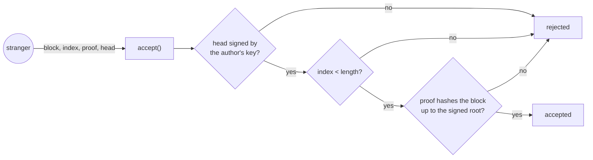
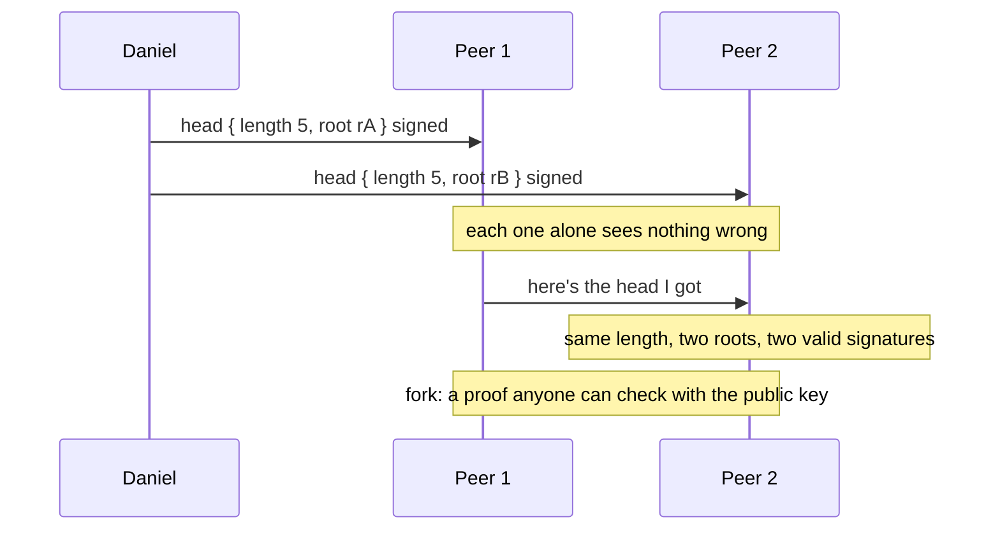
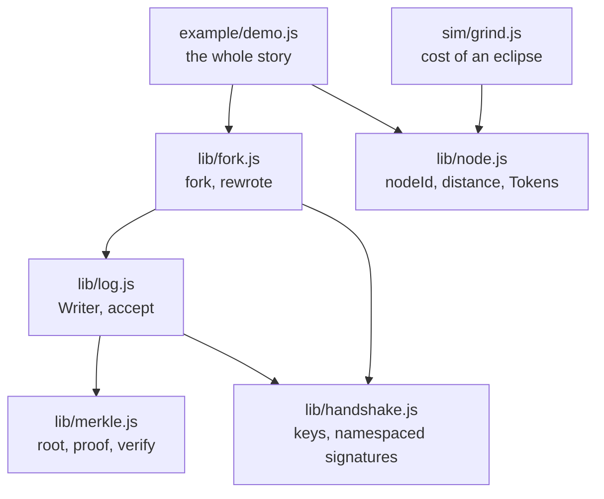
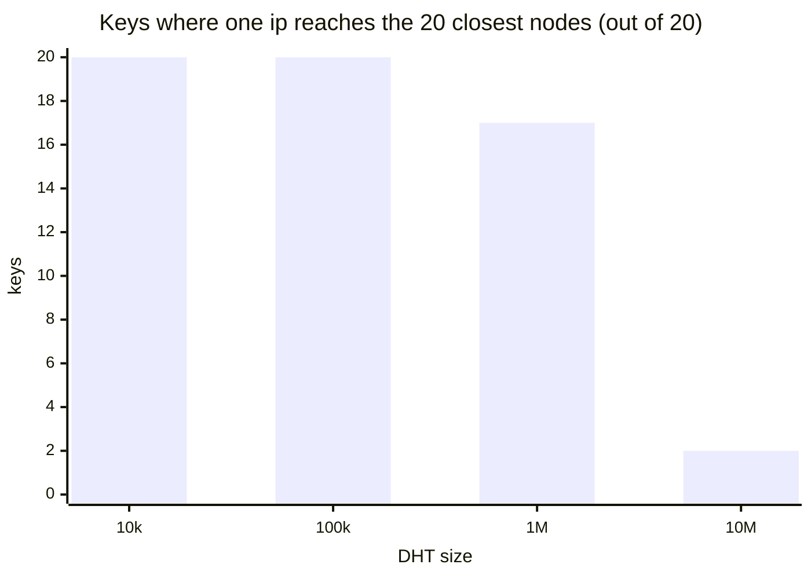

# trust

In a P2P network there is no server to ask "is this real?". A peer says it's Daniel. A
stranger hands you block 5 of Daniel's log. A DHT node says it lives next to the key you're
looking for. Why believe any of them? A blockchain answers with consensus: everyone agrees,
and agreeing costs work. This repo answers without it, one question at a time, the way
append-only P2P logs do: don't trust the sender, check the keys, hashes and signatures.

## How it works

```
peer      a public key. Proves it owns it by signing a fresh nonce         lib/handshake.js
block     hashed into a Merkle tree. The author signs only the root        lib/merkle.js
head      { length, root, signature }: a log anyone can serve              lib/log.js
fork      two signed heads, same length, different roots: proof of a lie   lib/fork.js
node id   hash(ip:port), not chosen. A token proves the ip is real         lib/node.js
```

| Question                                  | What answers it                                                         |
| ----------------------------------------- | ----------------------------------------------------------------------- |
| is this peer who it says it is?           | it signs a random nonce we just made. Old answers can't be replayed     |
| can I take a block from a stranger?       | the block, its Merkle proof and the author's signed head must all match |
| can a signature be reused somewhere else? | every signature starts with a namespace: `trust/handshake`, `trust/log` |
| what if the author lies?                  | two signed heads that disagree are a proof anyone can check             |
| can a node pick its place in the DHT?     | its id is the hash of its address, and a token proves the address       |

A peer accepts a block from anyone, because it never trusts the sender:



The proof is only the siblings on the way up. For block 2 of 5, three hashes:

```
                root            <- the author signs only this
              /      \
          p0123      [h4]       <- sibling 3, on the right
         /     \
     [p01]      p23             <- sibling 2, on the left
               /   \
             h2    [h3]         <- sibling 1, on the right
             ↑
          leaf("c")
```

With 100,000 blocks it's 17 hashes. With a million, about 20.

### When the author lies

Every check above trusts the author's key. A log has one writer, so if two heads with the
same length and different roots are both signed by that key, it can't be an accident:



The other way to lie is rewriting the past while the log grows: sign 3 blocks, then sign 5
whose first 3 are different. `rewrote()` hashes the first 3 of the new blocks and compares
them with the old root.

### Without a blockchain

| Problem                           | Blockchain (proof of work)              | Here                                          |
| --------------------------------- | --------------------------------------- | --------------------------------------------- |
| who wrote this?                   | signature                               | signature                                     |
| was it changed?                   | hash chain                              | signed Merkle root + proof                    |
| what if the writer lies?          | the network picks a side, longest chain | two signatures are the proof, no vote         |
| fake identities                   | every vote costs hashes                 | id = hash(ip:port), token proves the ip       |
| **one order agreed by strangers** | **this is what proof of work is for**   | **not needed: every log has a single writer** |

Proof of work buys a global order between strangers, so nobody spends the same coin twice.
With one writer per log there's nothing to order, so there's nothing to mine.

---

## Run it

```bash
npm test                 # 47 tests
npm run coverage         # fails below 100% lines, branches and functions
npm run demo             # the whole story in the terminal
npm run sim              # how close one ip gets to any key in the DHT
```

```
1. handshake: prove you own the key
  accepted  daniel signs our fresh nonce
  rejected  an impostor claims to be daniel, signs with its own key
  rejected  someone replays an answer daniel gave earlier

2. signed log: take a block from anyone
  daniel signs the head: length 5, root 71388877f59c...
  mallory serves block 2 "meet at 8" with 3 hashes of proof
  accepted  block 2, checked against daniel's key, not mallory's word
  rejected  mallory changes it to "meet at 9"
  rejected  mallory signs her own version of the log
            a log of 100,000 blocks needs only 17 hashes to prove one

3. namespaces: a signature only counts for its purpose
  rejected  daniel's handshake answer passed off as a signed head

4. forks: catch the author lying
  accepted  peer 1 alone: block 4 "e" checks out
  accepted  peer 2 alone: block 4 "X" checks out
  fork       the peers compare heads: true
  rewrite    3 blocks became 5, but block 1 changed: true

5. dht: the id comes from the address
  accepted  a write from 1.2.3.4 echoing the token it got
  rejected  a write with a forged source 5.6.7.8 and no reply ever received
```

---

## Code



Read it bottom-up: `handshake.js`, `merkle.js`, `log.js`, `fork.js`, then `node.js`.

---

## What gets signed

Every signature is over a namespace plus the data, so a signature made for one purpose
never verifies for another:

| Namespace         | Data                         | Signed by        | Checked by       |
| ----------------- | ---------------------------- | ---------------- | ---------------- |
| `trust/handshake` | the 32-byte nonce            | the peer         | whoever asked    |
| `trust/log`       | length (8 bytes) + root (32) | the log's author | anyone, any time |

Without namespaces this breaks: the nonce is chosen by someone else and has the same size
as a root. An attacker sends a fake root as the "nonce", the author signs it thinking it's a
handshake, and the attacker now holds a valid signed head. The demo runs that attack.

A block reply, what any peer may send:

| Field   | Meaning                                                 |
| ------- | ------------------------------------------------------- |
| `block` | the data                                                |
| `index` | its position, must be below `head.length`               |
| `proof` | `[{ hash, left }]`, the siblings on the way to the root |
| `head`  | `{ length, root, signature }`, signed by the author     |

---

## How it evolved

Each step was added because the previous one left a question open.

| Step         | Added                                                  | What broke, or what it showed                                                                                                                                                                                                                                                                   |
| ------------ | ------------------------------------------------------ | ----------------------------------------------------------------------------------------------------------------------------------------------------------------------------------------------------------------------------------------------------------------------------------------------- |
| Handshake    | sign a fresh nonce, verify with the claimed key        | **bug:** `sign(nonce, key)` instead of `sign(null, nonce, key)`, and the key passed as text. Both threw, and the `catch` returned `false` for everyone, the real owner included. A test that only checked "the impostor fails" would have passed. The first test is now "the real owner passes" |
| Merkle root  | leaf `0x00`, parent `0x01`, the odd node goes up alone | hashes started as hex strings, converted back at every level. Buffers end to end, hex only for printing. Duplicating the odd node would give `[a, b, c]` and `[a, b, c, c]` the same root, the Bitcoin bug                                                                                      |
| Merkle proof | siblings on the way up, with their side                | the side matters: `parent(a, b)` is not `parent(b, a)`. Swapping every `left` in a valid proof is rejected                                                                                                                                                                                      |
| Signed log   | `Writer`, `head()`, `accept()`                         | `accept` started inside the class, but the reader never has the author's `Writer`, only a public key and a reply. It's a plain function                                                                                                                                                         |
| Namespaces   | `trust/handshake` and `trust/log`                      | the log made the handshake dangerous: a nonce has the size of a root, so a handshake answer could be passed off as a signed head                                                                                                                                                                |
| Fork         | two heads, same length, different roots                | **bug:** the first try built the signature with `respond()`. The checker never has the author's secret key, and shouldn't: signing is the author's job, checking is anyone's                                                                                                                    |
| Rewrite      | a longer head whose beginning changed                  | **bug:** two conditions were inverted: it only looked at heads of the same length, which is `fork()`'s job, and it called an unchanged beginning a rewrite. It also has to check that the blocks hash to the new root, or anyone could "prove" a rewrite with invented blocks                   |
| Node id      | `hash(ip:port)`, XOR distance                          |                                                                                                                                                                                                                                                                                                 |
| Tokens       | `hmac(secret, ip)`, `timingSafeEqual`                  | **bug:** the hmac had no key, so the token was a plain hash of the ip that anyone could compute, the spoofer included                                                                                                                                                                           |
| Grind        | try every port of one ip against a key                 | one ip gets into the 20 closest of a million-node DHT for most keys. The hash makes the attack cost ips, it doesn't make it impossible                                                                                                                                                          |

Rules that came out of it: the first test is always the honest case passing; whatever comes
from the network returns `false`, never throws; and every signature says what it's for.

---

## Results

`npm run sim`: one ip tries all 65535 ports against 20 random keys and keeps the id closest
to each. k leading bits shared means 1 in 2^k ids gets that close, so 65535 tries should
reach about 16.



| DHT size   | Bits to be in the 20 closest | Keys one ip got there for |
| ---------- | ---------------------------- | ------------------------- |
| 10,000     | 9.0                          | 20 / 20                   |
| 100,000    | 12.3                         | 20 / 20                   |
| 1,000,000  | 15.6                         | 17 / 20                   |
| 10,000,000 | 18.9                         | 2 / 20                    |

Bits shared with the key: mean 16.9, min 15, max 20.

- **The math holds.** 65535 tries, about 16 bits.
- **One ip can get close, it can't surround.** Being one of the 20 closest is cheap. Being
  all 20, to hide the key from everyone, takes many real ips.
- **Even surrounded, the data can't be faked.** Records and logs are signed, so an attacker
  in the middle can hide them, not change them. That's why integrity comes from signatures,
  and the address-derived id only makes hiding expensive.

---

## Tests

47 tests, 100% of lines, branches and functions across `lib/`, using only `node:test` and
its built-in coverage. Every module has a garbage test: `null`, wrong types and short
buffers must return `false`, never throw.

---

## Known limitations

| Limitation                     | Why it matters                                                                                                                  |
| ------------------------------ | ------------------------------------------------------------------------------------------------------------------------------- |
| No network                     | Everything runs in one process. The holepunch repo has the UDP side                                                             |
| No encryption                  | The handshake proves who you're talking to, it doesn't encrypt the conversation. Real P2P stacks run a Noise handshake for both |
| A simple Merkle tree           | Rebuilt from scratch on every `head()`. Hypercore keeps a flat tree and only updates the right edge                             |
| `rewrote()` needs the blocks   | A real log proves the old root is a prefix of the new one with a few extra hashes                                               |
| The token secret never rotates | A leaked token stays valid forever. Real DHTs rotate the secret and accept the previous one for a while                         |
| One hash for the node id       | sha256 of `ip:port` as text. Real implementations hash the binary address                                                       |
| No proof of work here          | The comparison with a blockchain is the table above, not code                                                                   |

---

## Background

- Hypercore, signed append-only logs: https://github.com/holepunchto/hypercore
- dht-rpc, the DHT under the Holepunch stack: https://github.com/holepunchto/dht-rpc
- Pear docs: https://docs.pears.com
